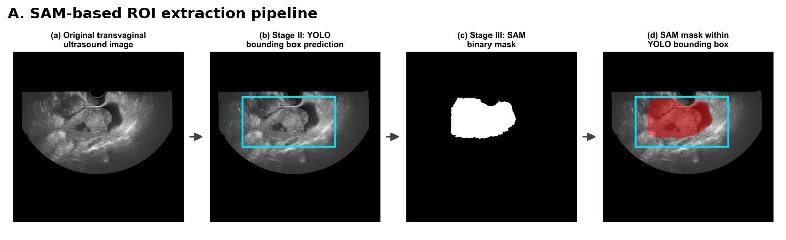
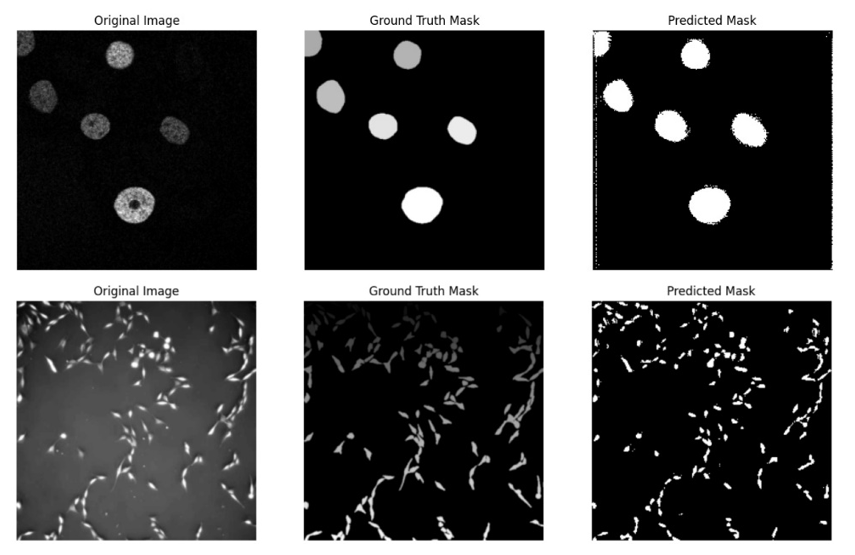
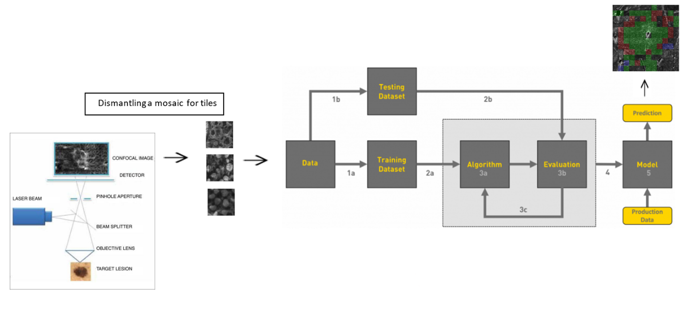

---
# Leave the homepage title empty to use the site title
title: ''
summary: ''
date: 2026-07-30
type: landing

design:
  spacing: '2rem'

sections:
  # Photo, name, role, links, short bio, and a two-line education summary.
  # The full education entries are in the timeline below.
  - block: resume-biography-3
    content:
      username: me
      text: ''
      button:
        text: Download CV
        url: uploads/Amit-Brilant-CV.pdf
      headings:
        about: ''
        education: 'Education'
        interests: ''
    design:
      # Light version (2026-10-08): the same stacked peaks, recoloured to a soft
      # sky-to-blue ramp, with dark text. Dark version: css_class: dark,
      # color '#001332', filename stacked-peaks-blue.svg.
      background:
        color: '#c9e2fb'
        image:
          filename: stacked-peaks-light.svg
          filters:
            brightness: 1.0
          size: cover
          position: center
          parallax: false
      name:
        size: md
      avatar:
        size: small
        shape: circle

  # Experience first, then Education, same card format. From data/authors/cv.yaml.
  - block: resume-experience
    id: experience
    content:
      username: cv
    design:
      date_format: 'Jan 2006'
      is_education_first: false

  # Three cards in one row (one column on mobile). Same text and links as before;
  # images chosen 2026-10-08. Styles in layouts/_partials/hooks/head-end/home-sections.html.
  - block: markdown
    id: projects
    content:
      title: Research & Projects
      text: |
        

        <article class="project-card">
        
        

        <h3><a href="projects/ovarian-tvus/">Ovarian Carcinoma Diagnosis from Transvaginal Ultrasound</a></h3>
        
M.Sc. thesis, with Meir Medical Center · 2026

        
Three-stage computer-vision pipeline: EfficientNet-B7 triage, YOLOv8 lesion localisation, and benign vs malignant classification fusing CNN embeddings with Segment Anything shape features. <strong>0.952 accuracy, 0.964 AUC</strong> at the patient level.

        
<a href="projects/ovarian-tvus/">Project page</a> · <a href="https://github.com/Amit-Brilant/ovarian-cancer-tvus-pipeline" target="_blank" rel="noopener">Code</a> · <a href="https://doi.org/10.5281/zenodo.20383744" target="_blank" rel="noopener">Dataset</a>

        

        </article>
        <article class="project-card">
        
        

        <h3><a href="projects/cell-segmentation-byol-unet/">Self-Supervised Cell Segmentation with BYOL and U-Net</a></h3>
        
M.Sc. course project · 2024

        
BYOL pretraining of a U-Net encoder on unlabelled microscopy, then fine-tuning for 3-class segmentation. <strong>Up to +12.4% mean SEG</strong> over the supervised baseline.

        
<a href="projects/cell-segmentation-byol-unet/">Project page</a> · <a href="https://github.com/Amit-Brilant/cell-segmentation-byol-unet" target="_blank" rel="noopener">Code</a>

        

        </article>
        <article class="project-card">
        
        

        <h3><a href="projects/virtual-biopsy-melanoma/">Virtual Biopsy for Early Melanoma Detection</a></h3>
        
B.Sc. final project, with Sheba Medical Center · 2022

        
ConvNeXt classification of reflectance confocal microscopy tiles, with a clinical penalty matrix built into both the loss and the metric. <strong>90.7% clinically weighted accuracy.</strong>

        
<a href="projects/virtual-biopsy-melanoma/">Project page</a> · <a href="https://github.com/Amit-Brilant/rcm-nevi-composite-pattern-classification" target="_blank" rel="noopener">Code</a>

        

        </article>
        

  # Badges in the style of the GitHub profile README. Same four groups and items
  # as the CV skill lines (career.yaml, Medical order).
  - block: markdown
    id: skills
    content:
      title: Skills
      text: |
        

        

<strong>Languages</strong>

<code>Python</code> <code>SQL</code> <code>MATLAB</code>

        

<strong>ML &amp; Computer Vision</strong>

<code>PyTorch</code> <code>scikit-learn</code> <code>XGBoost</code> <code>CNNs</code> <code>Object detection (YOLO)</code> <code>Image segmentation (U-Net, Segment Anything)</code> <code>Interpretable AI (Grad-CAM, SHAP)</code> <code>Self-supervised learning</code> <code>Image processing</code> <code>OpenCV</code>

        

<strong>LLMs &amp; AI Applications</strong>

<code>LLM APIs (OpenAI, Anthropic)</code> <code>RAG</code> <code>AI agents</code> <code>Prompt engineering</code> <code>LLM evaluation</code> <code>Hugging Face</code>

        

<strong>Data &amp; Tools</strong>

<code>pandas</code> <code>NumPy</code> <code>SciPy</code> <code>Statistics</code> <code>EDA</code> <code>ETL pipelines</code> <code>Data visualization (Plotly, Matplotlib, Seaborn)</code> <code>MongoDB</code> <code>Git</code> <code>Jupyter</code> <code>Streamlit</code> <code>Claude Code</code>

        

---
