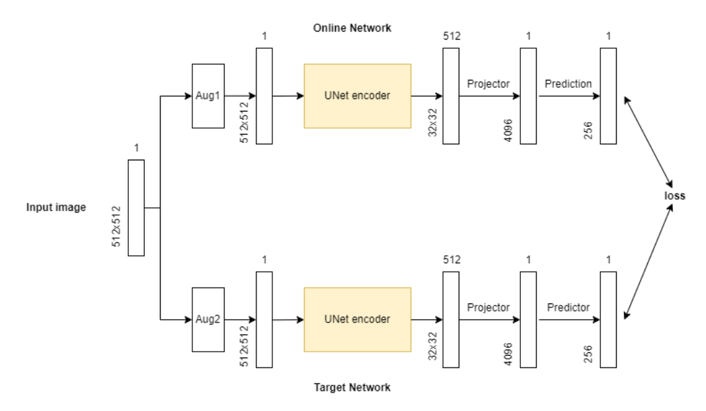
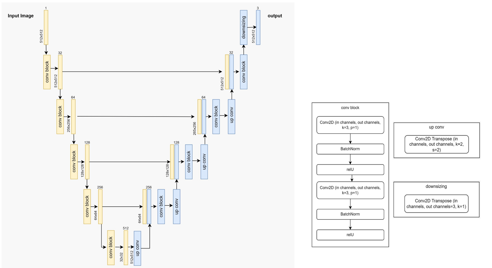
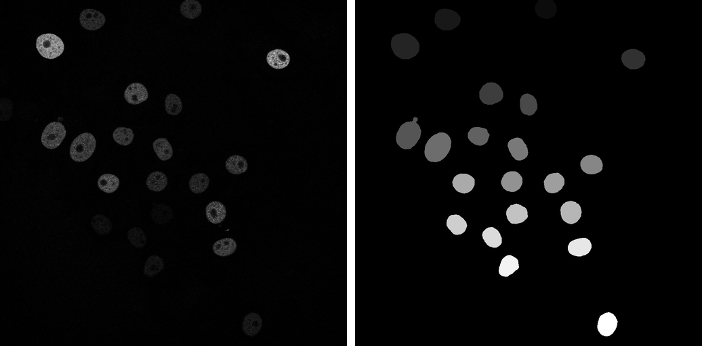
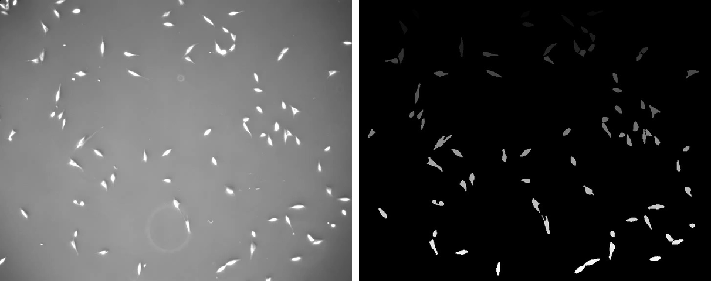
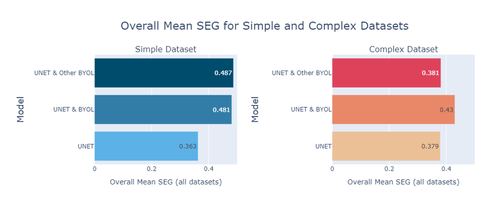

## Abstract

Segmenting cells is hard for an ordinary reason: cells vary enormously in shape, size and
texture, and labelled microscopy data is scarce because labelling it requires an expert with a
mouse. Every practical medical imaging project runs into the same wall.

This project attacks the wall directly. A UNet encoder is pretrained with **BYOL** on
*unlabelled* cell images, then fine-tuned for supervised segmentation. Across two datasets of
deliberately different difficulty and four labelled-set sizes, every pretrained variant beat
the supervised baseline, and the advantage was largest where labels were fewest.

## Method

**Stage 1, self-supervised pretraining.** Each unlabelled image is augmented twice and the two
views pass through an online network and a target network. The online branch adds a projector
and a predictor and is updated by gradient descent; the target branch is updated only by an
exponential moving average of the online weights, decay 0.99. No negative pairs, no labels.

**Stage 2, supervised fine-tuning.** The pretrained weights are loaded into a standard UNet and
trained with weighted cross-entropy. The encoder stays frozen for the first two thirds of
training so the gradient budget goes into the decoder, then it is unfrozen for the final third.
Input is 512x512x1, output is 512x512x3.

Binary masks are converted on the fly into a three-class map: connected components label each
cell, a Laplacian kernel marks their boundaries, and every pixel becomes background, inside or
edge. Modelling the edge class explicitly is what keeps touching cells apart.

## Data

Two 2D datasets from the Cell Tracking Challenge, chosen to differ in difficulty.

**Fluo-N2DH-GOWT1**, the simple case: well-separated fluorescent nuclei on a dark background.

**PhC-C2DL-PSC**, the complex case: many small, elongated, densely packed phase-contrast cells.

## Experimental setup

Three variants, four training-set sizes, two datasets. The encoder was initialised randomly
(the supervised baseline), from BYOL pretraining on the same dataset, or from BYOL pretraining
on the *other* dataset. Training sizes were 50, 100, 250 and 500 labelled images with a 20%
validation split, tested on 120 and 100 images respectively. Adam at lr 1e-4, batch size 8, on
a single Colab L4 GPU.

Results are reported with **SEG**, the Cell Tracking Challenge metric: the mean Jaccard index
over reference objects, where a prediction counts only if it covers more than half the
reference object. SEG punishes merged cells severely, which is why the edge class matters.

## Results

| Train size | Simple: UNet | Simple: + BYOL | Simple: + Other BYOL | Complex: UNet | Complex: + BYOL | Complex: + Other BYOL |
|---:|---:|---:|---:|---:|---:|---:|
| 50 | 0.32 | 0.41 | **0.53** | 0.16 | **0.31** | 0.23 |
| 100 | 0.52 | 0.60 | **0.63** | **0.49** | **0.49** | 0.45 |
| 250 | 0.38 | **0.59** | 0.49 | 0.39 | **0.45** | 0.35 |
| 500 | 0.24 | **0.32** | 0.29 | 0.47 | 0.47 | **0.50** |
| **Mean** | 0.363 | 0.481 | **0.487** | 0.379 | **0.430** | 0.381 |

Two findings are worth more than the headline number.

**Pretraining on a harder dataset helps an easier one.** On the simple dataset the encoder
pretrained on the *complex* images scored highest overall, 0.487, and dominated at the smallest
training set: 0.53 against 0.32 for the baseline at 50 images. Richer unlabelled data yields a
more general feature extractor. The reverse does not hold.

**More labels did not mean better scores.** Performance peaks at 100 images on both datasets
and then declines. Consecutive frames of a time-lapse sequence are almost identical, so
enlarging the labelled set adds repetition rather than information, and memorisation arrives
sooner.

## Qualitative results

Post-processing is a genuine trade-off. Assigning the predicted edge class to white merges each
cell with its own boundary and raises SEG, but neighbouring cells visually run together.
Assigning it to black draws a one-pixel gutter around every cell, which separates them far
better at the cost of a slightly lower score.

## Known limitations

Left in the repository rather than quietly corrected, because the reported numbers were
produced with this behaviour:

- `UNetDecoder.forward` applies a softmax and the training loop then passes that output to
  `nn.CrossEntropyLoss`, which applies `log_softmax` internally. A double softmax
- The original submission set no random seeds. A seed cell was added afterwards, but the
  reported numbers predate it
- The flattened encoder output hardcodes a 512x512 input
- Class weights differ slightly between the code and the report, though the ordering
  background < inside < edge is the same in both
