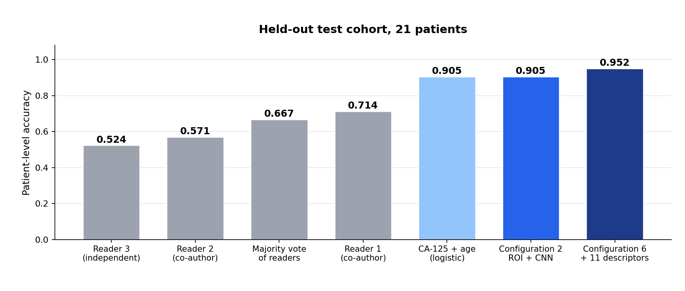
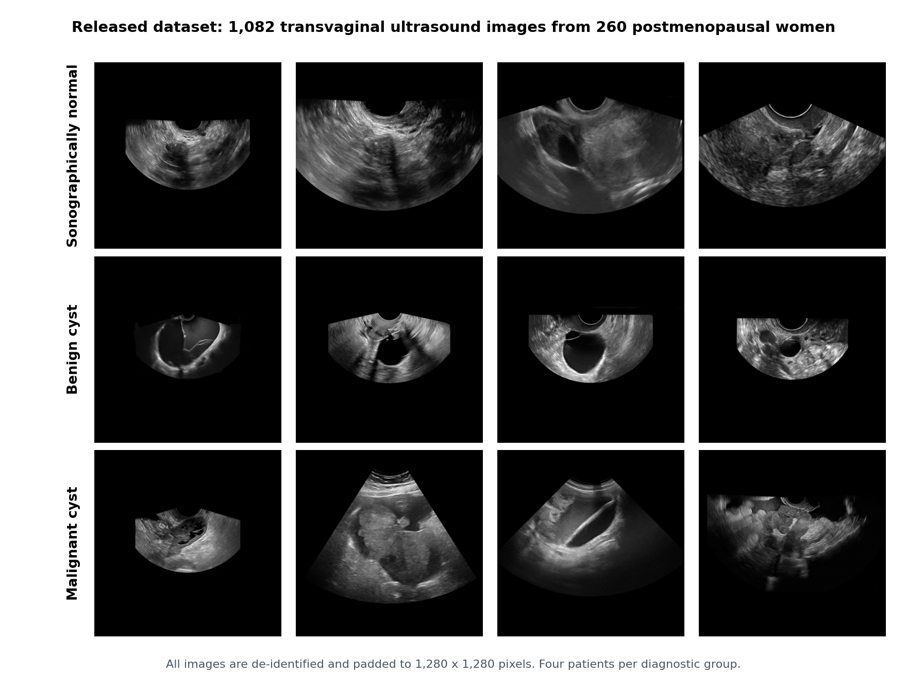

## Abstract

Ovarian carcinoma is diagnosed late because early disease is quiet and the imaging is
ambiguous. Transvaginal ultrasound is the first-line examination: it is cheap and it is
everywhere, but reading it is difficult and the reading varies between examiners. Structured
systems such as O-RADS reduce that variation without removing it, because an expert still has
to record what the lesion looks like.

This thesis builds a three-stage pipeline over transvaginal ultrasound in postmenopausal women
that reads the examination the way a gynaecologist does: triage the frame, find the lesion,
then characterise it. On the held-out test cohort the third stage reaches **0.952 accuracy and
0.964 AUC at the patient level**.

## Why three stages

A single end-to-end classifier is the obvious first attempt and the wrong one here. The three
questions are genuinely different problems.

**Triage** is a whole-image classification question. An EfficientNet-B7 backbone, trained with
a clinical CAM-loss, separates normal from pathological frames.

**Localisation** is a detection question. The malignancy decision depends on the lesion, not on
the surrounding tissue or the acoustic shadow behind it. A YOLOv8m detector finds the lesion and
hands the region of interest to the next stage. Faster R-CNN and YOLO11 were trained as
alternatives and compared.

**Characterisation** is where texture alone stops being enough. Clinicians read solidity, wall
irregularity and shape. So this stage fuses two representations: EfficientNet-B7 embeddings of
the cropped region, and eleven descriptors computed from a segmentation mask. Six fusion
configurations were trained and compared.

## Where the masks come from

The dataset has bounding boxes, not masks, and hand-segmenting lesions at scale was not
realistic. Segment Anything (SAM, ViT-H) closes that gap: each detector box is used as a
prompt, SAM returns a mask, and the descriptors are computed from it. No reader is involved at
inference time, and the masks regenerate deterministically from the released boxes.

This is the part of the pipeline I would defend first. It turns a foundation model into a
feature extractor for a problem it was never trained on, and gives the classifier the exact
properties clinicians actually use.

## Results

| Stage | Task | Model | Result |
|---|---|---|---|
| I | Normal vs pathological | EfficientNet-B7, clinical CAM-loss | Accuracy / AUC 0.974 / 0.997 (test, patient level) |
| II | Lesion localisation | YOLOv8m | mAP@0.5 = 0.746 (validation) |
| III | Benign vs malignant, Configuration 2 | EfficientNet-B7 on the crop | Accuracy / AUC 0.905 / 0.945 (test, patient level) |
| III | Benign vs malignant, Configuration 6 | + 11 SAM-derived descriptors | **Accuracy / AUC 0.952 / 0.964** (test, patient level) |

Two readings of this chart matter more than the headline. The descriptors add a real margin
over the image-only model. And a simple clinical baseline, CA-125 with age, is already strong
on this cohort, which is exactly why the comparison is shown rather than hidden. The test
cohort is 21 patients, so one patient moves accuracy by 4.8 points and most of these
differences are not statistically significant.

## Explaining the decision

- **Grad-CAM** on the last convolutional layer of the Stage III backbone, showing which region
  of the lesion drove the call
- **SHAP** and PCA over an XGBoost clinical pre-classifier, showing which clinical variables
  carry the signal independently of the imaging
- Bootstrap confidence intervals and paired tests rather than single point estimates

## The released data

1,082 transvaginal B-mode images from 260 postmenopausal women, 2012 to 2023, de-identified and
released with the annotations, clinical variables, descriptors, partitions, per-patient
predictions and trained weights. The code reimplements every experiment as one package, with
unit tests, so the pipeline runs end to end from the public release.

## Limitations

A medical imaging result without its boundary conditions is not a result.

- Single-centre cohort. Multi-centre external validation is the highest-priority follow-up
- 21 test patients for Stage III
- Stage I separation may partly reflect acquisition differences between the groups, and should
  not be read as a screening result
- Postmenopausal women only. No physical-scale calibration, so geometric descriptors are
  relative within this cohort. Doppler vascularity is not modelled

## Stack

PyTorch, EfficientNet-B7, YOLOv8, Segment Anything (SAM), XGBoost, SHAP, Grad-CAM,
scikit-learn, pytest, Python 3.10.
