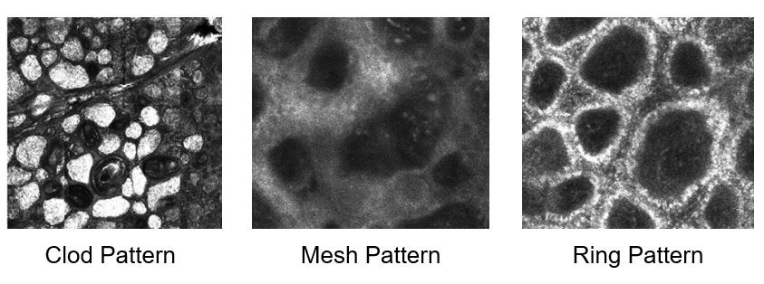
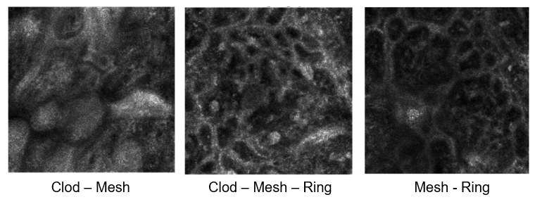
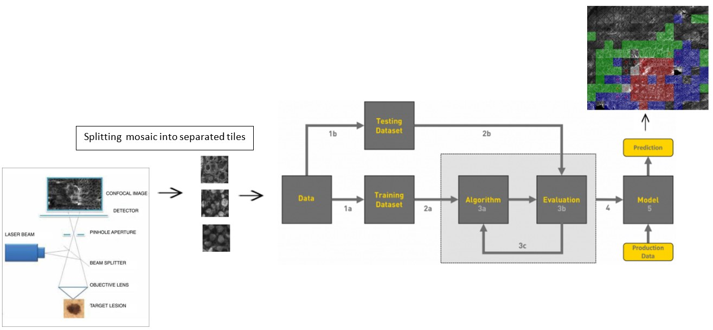
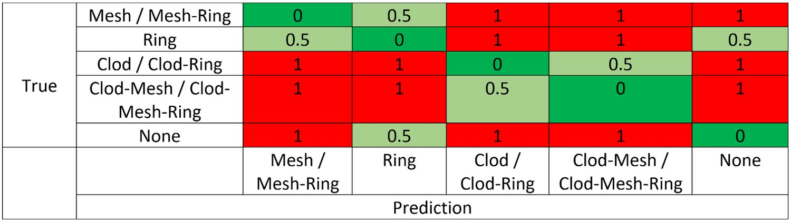
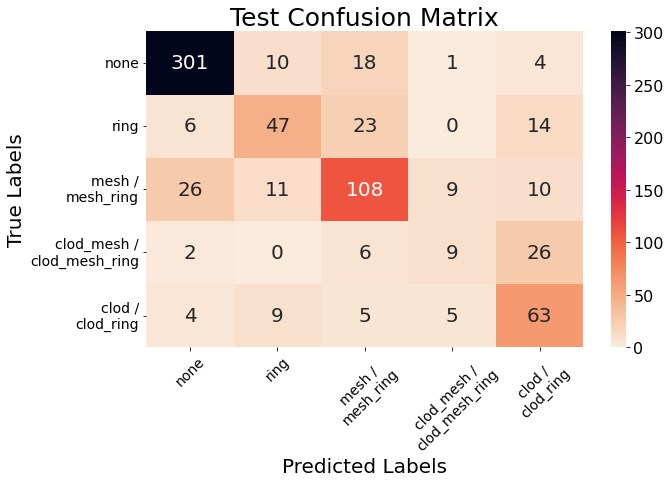
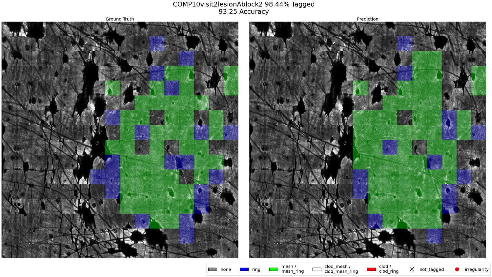
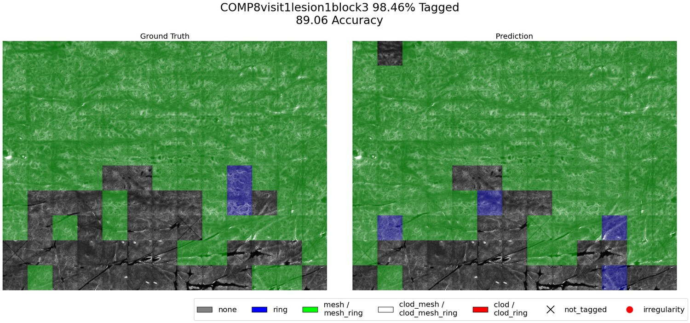
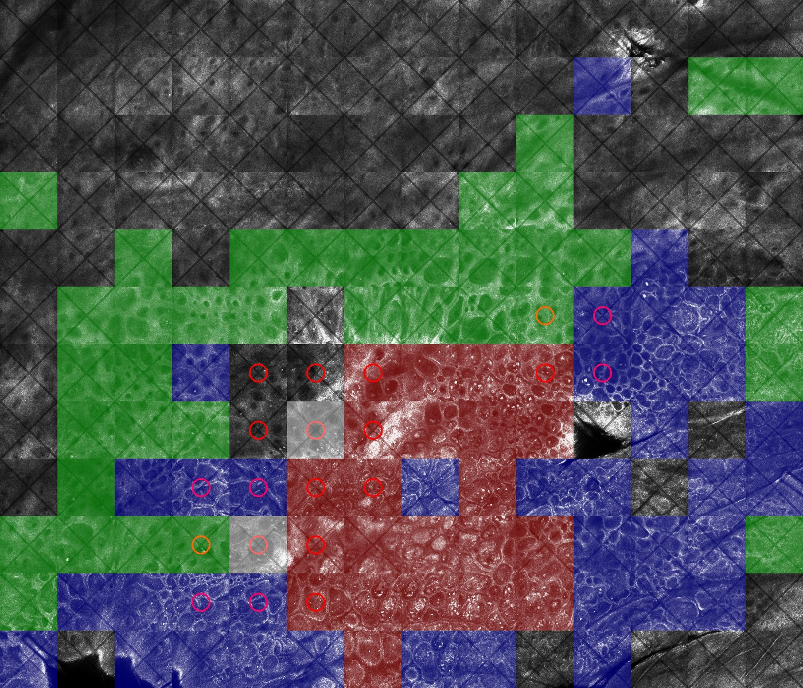
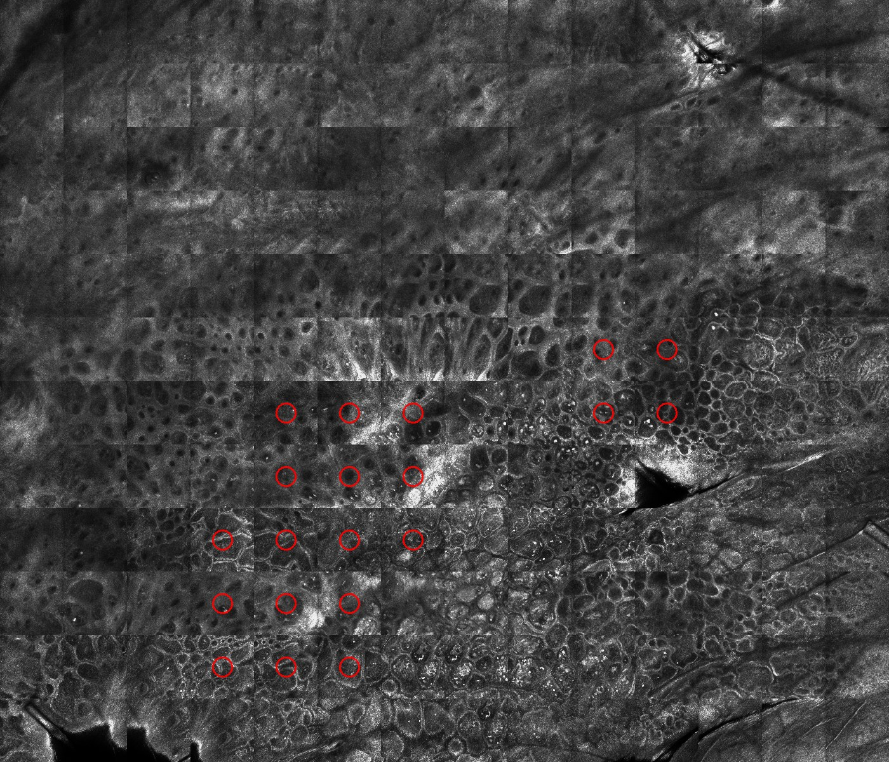

## Abstract

Reflectance Confocal Microscopy images skin at cellular resolution without cutting it, a
"virtual biopsy". One lesion is captured as a **mosaic** of 35 to 196 **tiles**, each
covering 0.5 mm × 0.5 mm. Every tile shows one of three cellular patterns (**clod**,
**mesh**, **ring**), a combination of them, or background, and reading those patterns is
how a dermatologist assesses a mole.

In real nevi the patterns nest inside one another, so a single tile routinely carries two
or three at once. These composite patterns are hard for an expert to label consistently,
which makes them hard to learn and hard to evaluate. This project, run with the
dermatology research team at Sheba Medical Center, trains a ConvNeXt classifier over
single tiles and paints its predictions back onto the mosaic to produce a tile-level
segmentation of the whole lesion. Two decisions taken jointly with the clinicians shaped
the result: eight pattern combinations were merged into five clinically equivalent
classes, and a penalty matrix encoding the clinical severity of each confusion was built
into both the loss function and the evaluation metric.

## The Problem

Three patterns plus background give eight possible combinations. Training on all eight
produced poor results. Reviewing the confusions with the medical team led to a merge:
combinations carrying the same clinical meaning were collapsed into a single class, a
grouping drawn from the team's prior published work. Fewer, clinically meaningful classes
improved accuracy *and* turned a predicted mosaic from a confetti of eight colours into
something a clinician can read.

A second departure from the literature: published work segments RCM mosaics **per pixel**,
but the clinicians asked for **per tile**. The tile is the unit they label and reason
about, so a tile-level map is one they can act on directly.

## Method

**Backbone.** ConvNeXt-Tiny from `timm`, ImageNet-pretrained and adapted to single-channel
224 × 224 greyscale input. Trained with AdamW under a cosine schedule with warm-up, 100
epochs, batch 32, and aggressive augmentation including unconstrained rotation, since a
nevus has no canonical orientation.

**Cost-sensitive loss.** Not every mistake costs the same. Confusing *mesh* with *ring* is
minor; confusing *clod* with background is not. The clinicians assigned a penalty to every
possible confusion, and that matrix is applied on top of a focal loss so the optimiser is
pushed away from *costly* errors rather than merely wrong ones.

Green is correct, light green a tolerable confusion, red a serious one. The same matrix
defines the reported metric.

## Results

Reported scores are clinically weighted: false positives and negatives are scaled by their
penalty before precision and recall are computed, then averaged by class support.

| Metric | Weighted (reported) | Plain |
| --- | ---: | ---: |
| Accuracy | **90.7%** | 73.6% |
| Precision | 77.0% | 73.2% |
| Recall | 76.9% | 73.6% |
| F1 | 76.7% | 73.0% |

### Per class, test set (717 tiles)

| Class | Support | Precision | Recall | F1 |
| --- | ---: | ---: | ---: | ---: |
| None | 334 | 88.8% | 90.1% | 89.5% |
| Mesh / Mesh-Ring | 164 | 67.5% | 65.9% | 66.7% |
| Ring | 90 | 61.0% | 52.2% | 56.3% |
| Clod / Clod-Ring | 86 | 53.8% | 73.3% | 62.1% |
| Clod-Mesh / Clod-Mesh-Ring | 43 | 37.5% | 20.9% | 26.9% |

Performance tracks class support almost exactly. The rarest composite class is the weakest
by a wide margin, and it is also the hardest one for a human to label. Most of its misses
go to *clod / clod-ring*, a confusion the penalty matrix rates as low severity. The honest
read: the model reliably separates lesion from background and is competent on mesh, but it
has not solved the composite classes. That needs more labelled composite tiles, not a
different architecture.

## Mosaic-Level Outputs

Two test mosaics, ground truth on the left and prediction on the right. Where the model
drifts it does so at lesion boundaries rather than inventing structure inside the mole.

### Irregularity index

A fully coloured mosaic can still be too much information at once. A second layer flags
disagreement between neighbours: a 3 × 3 window slides across the mosaic, and where the
nine tiles carry three or more distinct predictions, the centre tile is circled in red.
Heterogeneous, asymmetric regions are exactly what clinicians are trained to treat as
suspicious, so this reduces a wall of colour to a short list of places to look.

## Takeaways

- **Clinical reasoning beat validation curves.** The eight-to-five merge was proposed on
  clinical grounds and improved the model as a side effect. The largest single gain came
  from a domain decision, not an architectural one.
- **The metric is part of the model.** Encoding error severity into both loss and
  evaluation changed what the network optimised for. A flat accuracy score would have
  hidden that most remaining errors are the tolerable kind.
- **Tile-level beat pixel-level here** not because it is technically superior, but because
  it matches the unit clinicians label and act on.
- **The bottleneck is labels, not capacity.** Every weak class is a small class.
